<!-- Replace the social links (YOUR_LINKEDIN, YOUR_FACEBOOK, YOUR_NUMBER, YOUR_WEBSITE, email) below. -->

  

  

  
  

---

## 🚀 About Me

- 🔍 **Full Stack SEO** — technical SEO, on-page, content strategy, link building, local SEO & AI search (GEO/AEO)
- ⚙️ **Automation** — business workflows with n8n, Make & Zapier that save hours every week
- 🤖 **AI Agent Deployer** — building & deploying LLM agents, chatbots and RAG pipelines
- 📈 **SMM & Ads** — Meta, Google & TikTok ad campaigns focused on ROAS
- 🎨 **AI-Powered Graphics & Motion Design** — brand visuals, ad creatives, motion graphics
- 💻 **AI-Powered Web Design & Development** — fast, SEO-ready, conversion-focused websites
- 🎬 **AI Video Generation** — reels, ads & explainers with next-gen AI video tools
- ⚡ Fun fact: I turn ideas into automated, ranking, revenue-making systems
---

## 🛠️ Tech & Tools

<h3 align="center">💻 Web Development</h3>

  

<h3 align="center">🎨 Design & Motion</h3>

  
  
  
  
  
  
  
  
  
  
  
  
  
  
  
  

<h3 align="center">🤖 AI & Automation</h3>

  
  
  
  
  
  
  
  

<h3 align="center">🎬 AI Visual & Video</h3>

  
  
  
  
  
  
  
  

<h3 align="center">📈 SEO & Marketing</h3>

  
  
  
  
  
  
  
  
  
  
  
  
  
  
  
  
  
  
  

<h3 align="center">🧠 Technical SEO</h3>

  
  
  
  
  
  
  
  
  
  
  
  

<h3 align="center">📣 Ads & Social</h3>

  
  
  

---

## 🌟 Featured Projects

<!-- Edit descriptions and links -->
| Project | What it is |
|---|---|
| 🏍️ [Bikekhorcha.com](https://bikekhorcha.com) | Short one-line description |
| 🚀 [Bikesta](https://github.com/Bappy0009/Bikesta) | Short one-line description |
| 🎬 [Videosta](https://github.com/Bappy0009/Videosta) | Short one-line description |
| 🧰 [ToolsBD](https://github.com/Bappy0009/toolsbd) | Short one-line description |
| ✅ [Editask](https://github.com/Bappy0009/Editask) | Short one-line description |

---

## 🏍️ On the Road

  

## 📊 GitHub Stats

  
  

---

## 🤝 Let's Connect

  
  
  
  
  

  

